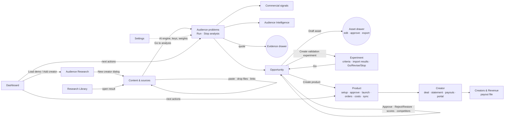

# Live app QA report — AudienceOS 1.5.1 (2026-11-16)

This pass operated the running app the way a person would, on top of the code-level audit that produced 1.5.0 (`APP_AUDIT.md`, `QA_MATRIX.md`, `ISSUE_TRACKER.md`). That work was not repeated.

**How it was run**
- A scratch copy only: the app server on port 8761 with its own data folder, and a private local AI engine (Ollama, port 11435) using the bundled models.
- Chrome ran with `--headless=new` only, so nothing appeared on screen.
- Clicks are real mouse events at the element's position on screen (`e2e/human.js` also records what was under the pointer), and text is typed key by key. Tests also used the keyboard only, real file-chooser and drag-and-drop uploads, CDP network throttling (1.5 s latency, 50 kB/s), two tabs at once, stopping the AI engine and the app server mid-task, and phone (390 px) and desktop (1440 px) widths in light and dark.
- Screenshots were opened and looked at, not just saved. The app scrolls inside `<main>`, so the "full page" shots grow the viewport to show the whole page.
- The real local model (`qwen2.5:7b`) ran **two full analyses** on fresh data (33 signals · 5 problems · 3 opportunities both times, 7 min 13 s and 7 min 18 s). It also ran three more that were stopped or interrupted on purpose, and drafted **6 assets** (52–100 s each).
- No checkout, payment, messaging or paid API calls were made. The Keychain was off (`AUDIENCEOS_NO_KEYCHAIN=1`). `~/AudienceOS/data` was not written during testing.

## Verdict

**Ready for the 3 supervised creator pilots on this Mac.** Every core journey now works when driven by hand: the mouse, the keyboard alone, a phone-width window, two windows at once, a slow network, and the AI engine or the app going away mid-task.

This pass found **21 real defects** that the code-level audit missed. All 21 are fixed and re-checked in the browser. The serious ones were in money:
- an abandoned deal edit could be saved later by accident;
- a second window could silently overwrite newer deal terms or product price.

It is **still not ready for unsupervised public use**, for these reasons:
- the checkout syncs and external AI providers have never touched a real account;
- there's a single background worker, so imports queue behind a 7–10 minute analysis;
- there are no accounts or hosting;
- two contract questions are still open (below).

## Coverage (final round, fresh database, 1.5.1)

| Check | Result | Evidence |
|---|---|---|
| J1 first run: Load demo by mouse → sources ready → Run analysis → repeat click → refresh and Back mid-run → results | **9/9** | `e2e/5_live_first_run.js`, `qa/screenshots/j1-*.jpg` |
| Original full journey (opportunity → experiment → asset → product → orders → deal → payout → statement/CSV/PDF/portal → reports) | **33/33** | `e2e/2_full_journey.js` |
| J2 create/edit by keyboard and mouse: dialog focus, bad follower count, stray click, paste, duplicate paste, drag-and-drop, file chooser by Enter, edit → Cancel → edit → save → refresh, blank name, channel edit/remove, delete audience | **23/23** | `e2e/7_live_create_edit.js`, `j2-*.jpg` |
| J3 money, all typed: launch gate, hand-typed orders, refund > sale, triple-click on a throttled network, CSV import, cost, delete with Cancel/OK, 70/30, abandoned deal edit, two windows on one deal, payout triple-click, screen = CSV = creator view, two windows on one product, blank product name, retire → reopen | **22/22** | `e2e/8_live_money.js`, `j3-*.jpg` |
| J4 interruptions: Stop analysis → next run still works; AI engine killed mid-analysis; engine back without reload; app server killed and back → "Try again" | **10/10** | `e2e/10_live_interruptions.js`, `j4-*.jpg` |
| J5 rest of the feature map: reject → restore, score override, competitor add/remove, web research refused without a key, real local-model draft → edit → Escape asks → save → approve → unapprove → delete, Revise/Stop/delete experiment, evidence drawer by keyboard, Library search → filter → open → Back, settings persist, bad weight refused, theme persists, report HTML | **24/24** | `e2e/11_live_features.js`, `j5-*.jpg` |
| J6 back up database; remove demo project (Cancel keeps it) | **5/5** | `e2e/12_live_cleanup.js`, `j6-*.jpg` |
| Visual: 17 populated screens × phone/desktop × light/dark, cut-off and overflow detection, screenshots reviewed | **68/68** | `e2e/9_live_visual.js`, `v-*.jpg` (six kept in the repo) |
| Route sweep (from the audit): 27 routes × 2 widths × 2 themes | **108 loads, 0 real problems.** The 8 flagged are the deliberate "not found" pages | `e2e/3_route_sweep.js` |
| Edge cases (from the audit) | **30/30** | `e2e/4_edge_cases.py` |
| Backend suite | **123 passed** (117 → 123) | `cd backend && AUDIENCEOS_OLLAMA_URL=http://127.0.0.1:9 .venv/bin/python -m pytest` |
| Frontend build | clean (`tsc --noEmit` + Vite) | `npm run build` |

**Totals:** 224 live browser checks plus 108 route loads were run: 224 passed, 0 failed. 6 groups are blocked and 7 areas are untested (both listed below).

**Inventory:** 18 routes, 209 visible controls (`qa/inventory.json`, from `e2e/6_inventory.js`). Every route was visited, and every control family was exercised at least once: buttons, links, tabs, filters, form fields, checkboxes, dropdowns, drop zone, file chooser, drawers, dialogs, theme toggle.

**Blocked (no keys or registrations, by rule):**
- Stripe, Gumroad, Shopify and Lemon Squeezy sync;
- Anthropic/OpenAI;
- the YouTube Data API and Brave search;
- YouTube OAuth, Meta and TikTok.

**Untested live:**
- "Retrieve links" (needs internet; skipped to make no outside requests);
- saving API keys (Keychain kept off);
- model download;
- the payout CSV for a non-demo creator (the demo creator is excluded by design);
- Windows/Linux;
- screen-reader speech (only roles, labels and focus were checked);
- UTF-16 CSV (known open, O-01).

## Workflow graph (how a person moves through the app)



Paths actually walked end to end: D→R→S→P→E, P→O→X→O→PR→C, O→A, L→S→Back, ST→reload, and C/PR in two windows at once.

## Bugs found and fixed

Severity: **P1** = wrong money or lost data with no warning. **P2** = a broken journey for some users (keyboard, phone, a second window), or silently lost input. **P3** = friction or polish.

| ID | Sev | What a person hit | Root cause | Fix | Re-test (live) |
|---|---|---|---|---|---|
| L-01 | **P1** | On a creator: Change terms → 70% to 60% → **Cancel**. Later: Change terms → edit a note → Save. **60% was saved**, and every balance moved. | The deal form kept the abandoned values; Cancel only hid it. | The form reloads the saved terms every time it opens. | J3 "Cancel discards an abandoned 60% edit" · `j3-06-deal.jpg` |
| L-02 | **P1** | Window A opens the deal; window B saves 65%; A saves a note → **back to 70%, silently**. | Saving always replaced the active deal. | The editor sends which deal it started from. The server refuses with "changed in another window… Nothing was saved" (409). | J3 two-window check · `j3-07-deal-conflict.jpg` · `test_stale_deal_editor_cannot_overwrite_newer_terms` |
| L-03 | P2 | A stale product tab saving notes **reverted a newer price**. | The product form sent every field. | It sends only the fields changed on that page. | J3 two-window product · `test_blank_product_name_refused_and_partial_patch_keeps_other_fields` |
| L-04 | P2 | Followers typed "12,5k" → creator saved **with no count, no message**. Channel errors showed behind the dialog. | `Number("125k")` = NaN, sent as null. | Accepts 12500 / 12,500 / 12.5k / 1.2M. Anything else gets a plain message; channel errors show inside the dialog. | J2 · `j2-03-bad-followers.jpg` |
| L-05 | P3 | A blank creator name was ignored silently; a blank audience or product name was saved. | No blank check on edits. | "can't be blank" (422), shown next to the form. | J2/J3 · `test_blank_names_are_refused` |
| L-06 | P2 | In a dialog, Tab went to the sidebar behind it. A stray click on the dim background **threw away the typed form**. | No focus trap; the overlay closed the dialog. | Focus stays in the dialog, starts on the first field and returns on close. Only ✕, Cancel or Esc close it. | J2 · `j2-02-modal-tab.jpg` |
| L-07 | P2 | The keyboard couldn't open the file chooser. | The drop zone was a plain div. | It's a button: Tab, then Enter/Space. | J2 "file chooser opens via Enter" |
| L-08 | P2 | The keyboard couldn't expand a problem (to see its quotes) or open a source. | Clickable table rows weren't focusable. | Rows are focusable, with Enter/Space and `aria-expanded`. | J5 |
| L-09 | P2 | Enter on a quote opened the evidence drawer and **closed it instantly**. | The Enter key's default "click" landed on the drawer's newly focused ✕. | `preventDefault` on Enter/Space. | J5 "drawer opens with Enter and takes focus" · `j5-04-evidence-drawer.jpg` |
| L-10 | P2 | No way to stop a 7–10 minute analysis started by mistake. | Cancel existed only in the API. | **Stop analysis** button with a confirmation; earlier results stay. | J4 · `j4-02-stopped.jpg` |
| L-11 | P3 | AI engine dies mid-run: "Local AI engine unreachable: RemoteProtocolError", and the button stayed greyed out until a reload. | Error text from the HTTP library; engine status was fetched once. | Plain message; the status is re-checked every 5 s while the engine is down. | J4 "Reanalyze available again without reloading" · `j4-03-engine-down.jpg` |
| L-12 | P2 | Phone: the status filter hid "Validated/Rejected". The audience profile and tables were cut off at the card edge. The new-creator channel row had 20 px inputs and the ✕ outside the dialog. | `overflow:hidden`. Phone rules came before the base rules, so they lost. Fixed 5-column grid. | Filters wrap; label/value lists stack; tables scroll inside the card; the channel row is two lines. Phone overrides moved to the end of the CSS. | Visual 68/68 · `v-phone-light-intel.jpg`, `v-phone-light-newcreator.jpg`, `v-phone-light-opps.jpg` |
| L-13 | P3 | Desktop: the opportunity score table spilled past its card. | Long header with no wrapping. | "Score" with "1–5" beneath it. | Visual · `v-desk-light-opp.jpg` |
| L-14 | P3 | Library: search → open a result → Back → **search gone**. | Filters lived only in memory. | Filters are kept in the address bar. | J5 · `j5-05-library-filter.jpg` |
| L-15 | P3 | Editing a draft asset, then Esc or a click outside → **edits lost**. | The drawer closed unconditionally. | Asks "Discard your unsaved edits?". | J5 |
| L-16 | P3 | Reject took one click, even on a validated opportunity with a launched product, and Restore puts it back to *Proposed*. | No confirmation. | Asks first and explains what Restore does. Not offered once a product exists. | J5 |
| L-17 | P3 | Channel Remove took one click (it changes the audience size used in scenarios). | No confirmation. | Asks first. | J2 |
| L-18 | P3 | The analysis model list offered `nomic-embed-text`, which can't analyze. | Unfiltered list. | Embedding models hidden; vision models labelled. | Visual settings |
| L-19 | P3 | "Add content first." shown while 3 imports were still waiting. | Imports are counted only once processed. | Shows "Waiting for N imports to finish (another analysis is running first)". | Screen review |
| L-20 | P3 | Dashboard activity grew without limit (50+ rows). | No cap. | Latest 8, plus "Show all". | `v-desk-light-dash.jpg` |
| L-21 | P3 | With the AI engine off, Settings showed the vision model as "None" although one was set. | The option list came only from installed models. | The current value is always listed. | Live read-only screenshot before the fix; visual after |
| — | infra | `e2e/2_full_journey.js` could hang forever in `browser.close()`. | Puppeteer close hang. | 5 s cap, then exit with a status. | Final run |

**Added:** a "Skip to main content" link for keyboard users.

## UI/UX before and after (plain words)

- **Forms forgive mistakes now.** A stray click, Escape while editing or Cancel no longer loses or leaks what you typed. Wrong input gets a sentence next to the field ("Followers: '12,5k' isn't a number. Type it like 12500, 12,500 or 12.5k.") instead of nothing.
- **Two windows are safe for money.** Before, the last save won silently. Now a stale deal save is refused with a reason, and a stale product save only changes what you edited.
- **Keyboard only is a complete path.** Skip link → create creator → paste/drop/choose files → expand problems → open evidence → close and land back where you were.
- **Phone width is usable.** Nothing important is cut off or unreachable (before/after pairs: `v-phone-light-intel.jpg`, `v-phone-light-newcreator.jpg`).
- **Long jobs are controllable.** Stop analysis. The engine-down message says what to do, and the button comes back by itself.
- **Less noise.** 8 activity items, no impossible model choices, and no "Add content first" while content is on its way.

## AI checks (real local model)

- **Analysis:** 33 signals, 5 problems and 3 opportunities on both fresh runs. Quotes open the source and are marked verified. Stopping, killing the engine and restarting all left previous results intact.
- **Drafts (offer, landing page):** the model used audience comments as if they were testimonials, and once invented a URL. The claim review caught all of them (3–9 flagged claims per draft), and Approve stays locked until the reviewer ticks the box. One rules flag was a false positive (a polite scheduling sentence marked as a superlative). **Verdict:** the guardrails work, and a human edit is required before anything is used. That is how the app is designed.
- **Web research without a Brave key:** refused in plain words; no call made.

## Remaining risks

1. **Single worker.** Imports and asset drafts wait behind a running analysis, up to ~10 min. After Stop, the cancelled model call still holds the worker for about 60 s. The screen now says why, but this is the biggest speed limit for a busy operator.
2. **Unsaved changes when leaving a page.** Editing the product setup or deal form and then clicking the sidebar loses the edits without a warning. Only dialogs and the asset editor guard against this.
3. **Same field edited in two windows (products):** the last save wins. Deals are protected.
4. **Restore after Reject** always returns an opportunity to *Proposed*.
5. **Text editing:** landing-page and calculator drafts can't be edited as text, and "Edit text" sits behind the Text tab.
6. **Untested and blocked items** are listed above. External money syncs are mock-tested only.
7. **Product questions left open, unchanged:**
   - do orders outside a deal's dates count?
   - do changed terms apply only to later sales?

   The statement warnings stay.

## Live app (port 8760, `~/AudienceOS/data`)

- **Before this pass:** not running.
- **Backup:** `data/` was backed up first to `data/backups/pre-1.5.1-<timestamp>/` (DB, -wal, -shm).
- **Start:** the real backend was started in the background with the start.sh uvicorn command, minus the window. The AI engine was not started.
- **Checks:**
  - It reported **1.5.1** and applied migration **005_evidence_survives_reprocess** (server log).
  - The live database has **no audiences, creators, products or sales** (it was already empty). The 3 saved settings were intact (vision model `qwen2.5vl:3b`, grouping on).
  - A headless, read-only look at Dashboard, Research, Creators, Library and Settings showed no errors. All non-GET requests were blocked, and none were attempted.
- **Afterwards:** that server was stopped (only its own PID) because it wasn't running before. The next `start.sh` opens 1.5.1 with the migration already applied.

## How to re-run (never against port 8760)

```sh
# scratch server + private AI engine, see TESTING.md for the full commands
cd ~/AudienceOS/e2e && npm install
node 5_live_first_run.js          # fresh data folder: loads the demo and runs the real analysis (~8 min)
node 2_full_journey.js && node 11_live_features.js && node 7_live_create_edit.js && node 8_live_money.js
node 3_route_sweep.js && node 9_live_visual.js && ../backend/.venv/bin/python -I 4_edge_cases.py
SCRATCH=/path/to/scratch ./run_interruptions.sh   # stops and restarts the scratch AI engine and server
node 12_live_cleanup.js           # removes the demo project
```
Screenshots go to `qa/screenshots/` (full-size PNGs are git-ignored; small JPG copies are committed).
